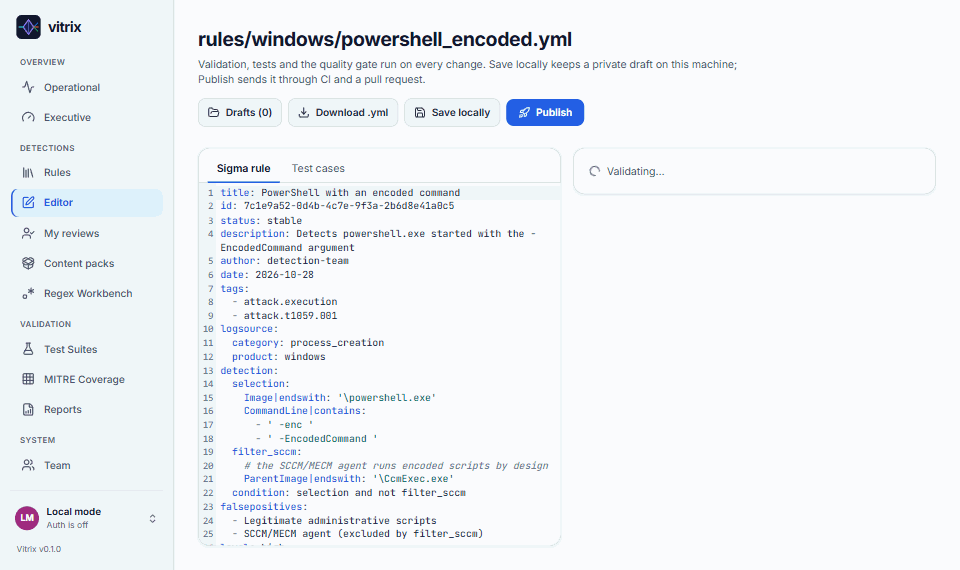
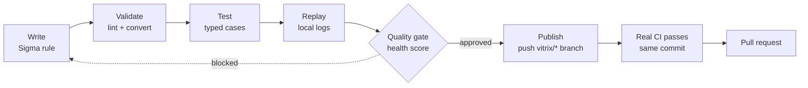
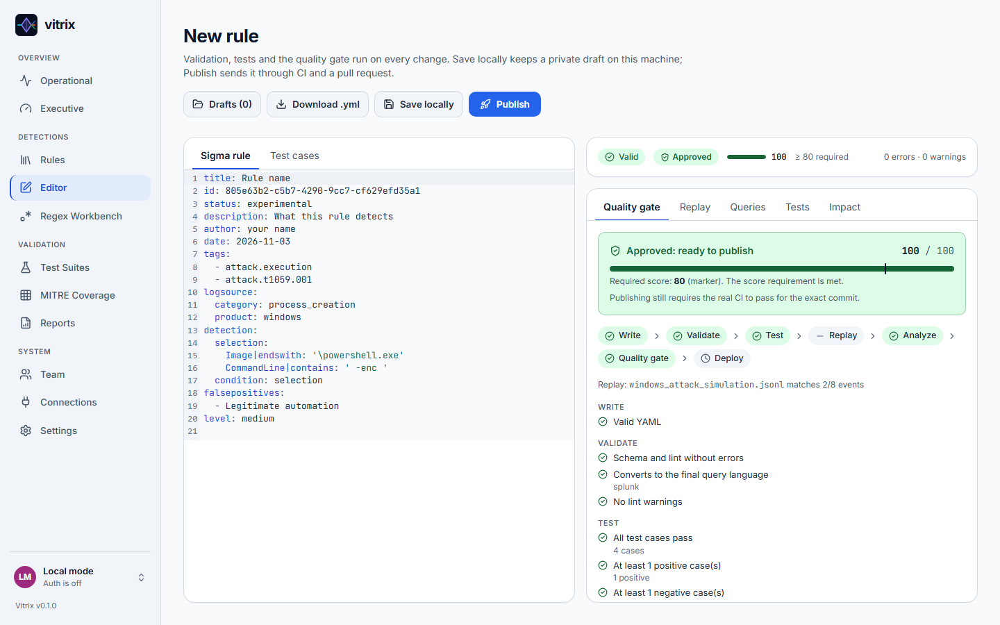
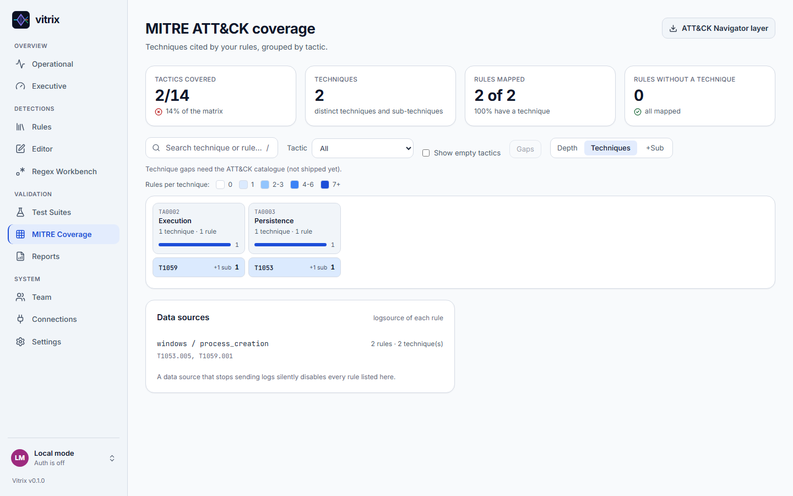
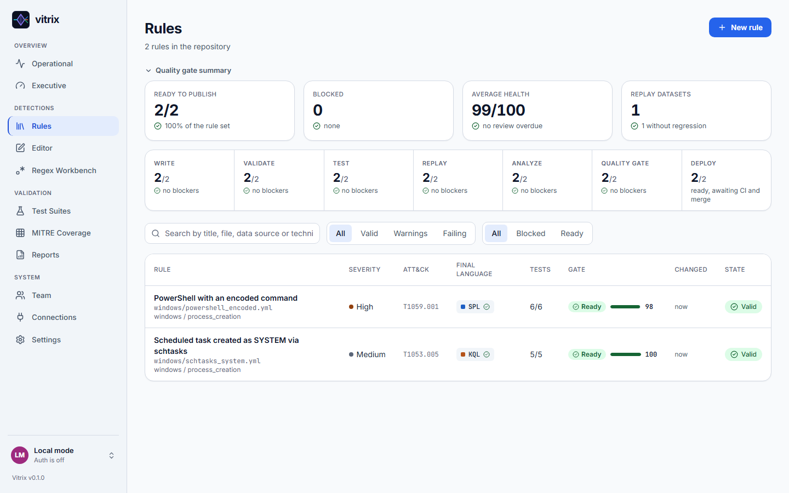

<div align="center">

<picture>
  <source media="(prefers-color-scheme: dark)" srcset="brand/vitrix-logo-on-dark.svg">
  
</picture>

**Write once. Detect on any SIEM.**

Detection-as-Code for [Sigma](https://sigmahq.io) rules: validate, test, replay, gate and ship through your own CI.

[](https://github.com/davivers/vitrix/actions/workflows/ci.yml)
[](LICENSE)
[](pyproject.toml)
[](#limits-of-this-version)



[Quickstart](#quickstart) · [Features](#features) · [Roles and security](#roles-and-security) · [CLI](#cli-cheat-sheet) · [Reference](#reference) · [Contributing](#contributing)

</div>

---

## What is Vitrix

Vitrix is a local tool for teams that keep detections as code. You write rules in Sigma; Vitrix checks them, converts them to the query language of each SIEM, runs your test cases and replays local logs against them. Nothing reaches your repository until a quality gate approves the rule and **your real CI passes for that exact commit**.

It needs no SIEM and sends nothing off your machine (GitHub is the only optional connection).



Not ready to publish? **Save locally** writes the rule into `rules/` like any other rule, flagged **"Local · not in Git yet"** until you publish it. Unsaved scratch work can be kept as a private draft, cleared when you sign out.

## Quickstart

Vitrix runs **inside your own detections repository**. This repository is the product, not your rules. `vitrix init` creates a detections repo with example rules, test cases, replay logs and a CI workflow.

<details open>
<summary><b>Option 1 - Docker</b> (no Python needed)</summary>

```bash
git clone https://github.com/davivers/vitrix && cd vitrix
docker build -t vitrix .

# first time: create a detections repo in ./detections
mkdir detections
docker run --rm -v "$PWD/detections:/workspace" vitrix init .

# serve the UI at http://localhost:8000
docker run --rm -p 127.0.0.1:8000:8000 -v "$PWD/detections:/workspace" -e VITRIX_GITHUB_TOKEN vitrix
```

With Compose (mounts `./detections`, publishes `127.0.0.1:8000`):

```bash
docker compose run --rm vitrix init .
docker compose up
```

Other commands: `docker run --rm -v "$PWD/detections:/workspace" vitrix check --strict --gate` (also `replay`, `report`). On PowerShell use `${PWD}` instead of `$PWD`. Accounts and drafts live in `detections/.vitrix/`.

**First run.** The image turns accounts on (`VITRIX_AUTH=on`) and generates a one-time setup token (`VITRIX_BOOTSTRAP_TOKEN=auto`). Open the setup link printed in `docker compose logs` (or `docker logs <container>`) to create the workspace owner; Save locally (drafts) then works out of the box. The token is new on every start and only matters until the owner exists. Keep the port on `127.0.0.1`: anyone who holds the link can become the owner. Set `VITRIX_BOOTSTRAP_TOKEN` to your own value (16+ characters) to choose it, or `VITRIX_AUTH=off` to disable accounts (not recommended).

</details>

<details>
<summary><b>Option 2 - Python virtual environment</b> (install scripts)</summary>

Needs Python **3.10 to 3.14** (3.12 recommended) and Git. Python 3.15 is not supported yet (no PyYAML wheel).

```bash
# Linux / macOS
git clone https://github.com/davivers/vitrix && cd vitrix
scripts/install.sh
. .venv/bin/activate
vitrix init ../my-detections && cd ../my-detections
vitrix serve                         # http://127.0.0.1:8000
```

```powershell
# Windows (PowerShell 5.1 or 7; one command per line)
git clone https://github.com/davivers/vitrix; cd vitrix
powershell -File scripts\install.ps1
.\.venv\Scripts\Activate.ps1         # if blocked: Set-ExecutionPolicy -Scope CurrentUser RemoteSigned
vitrix init ..\my-detections; cd ..\my-detections
vitrix serve                         # http://127.0.0.1:8000
```

Vitrix is distributed from GitHub only. Do not run `pip install vitrix`: that name on PyPI is not ours.

Without cloning, install straight from GitHub: `scripts/install.sh "vitrix[api] @ git+https://github.com/davivers/vitrix"` (Windows: `scripts\install.ps1 -Target "vitrix[api] @ git+https://github.com/davivers/vitrix"`).
`vitrix: command not found` means the virtual environment is not active; activate it in each new terminal.

</details>

<details>
<summary><b>Option 3 - From source</b> (developing Vitrix)</summary>

```bash
git clone https://github.com/davivers/vitrix && cd vitrix
python -m venv .venv && . .venv/bin/activate     # Windows: .\.venv\Scripts\Activate.ps1
pip install -e ".[dev]"
vitrix init ../scratch-detections && cd ../scratch-detections    # this repo's root has no detections
vitrix check --strict --gate && vitrix serve
```

UI development: `cd web && npm install && npm run dev` (port 5173, proxies `/api` to :8000).

</details>

### Connect to GitHub (to publish)

Create `your-org/your-repo` empty on GitHub, then, inside your detections folder:

```bash
gh auth login                        # once; Vitrix uses the GitHub CLI token
vitrix connect your-org/your-repo    # git remote + token + push access + workflow, one check at a time
vitrix serve
```

`vitrix connect` prints the exact command for the first missing step; run it until everything is checked. Without the CLI, put a fine-grained token (Contents and Pull requests read/write, Actions read) in `VITRIX_GITHUB_TOKEN`. `vitrix.yml` has a `github:` section for overrides; `github: false` turns GitHub off.

## Features

| Feature | What it gives you |
|---|---|
| **Editor** | One rule, everything live: validation with the exact line and a fix hint, the **final language** chosen from a menu (or "Sigma, no conversion"), queries per language with inline fixes (e.g. pick the KQL table), **Test & Replay** (cases and datasets in one table, field-level diff, compare with the saved version) and the quality gate |
| **Quality gate** | Blocking checks plus a 0-100 health score; a rule is approved only with no blocker and a score at or above `min_score` (default 80) |
| **Test cases** | Typed cases (positive, negative, false positive, edge) run by a local evaluator; exclusions are proven |
| **Log replay** | Try rules on JSON/JSONL/YAML logs and see which events match; never blocks a pull request |
| **MITRE ATT&CK coverage** | Matrix of tactics and techniques from your rule tags, drill-down to rules, ATT&CK Navigator export |
| **CI-first publishing** | Pushes a `vitrix/*` branch; the pull request opens only after the real CI passed for that exact commit (checked again server-side) |
| **Save locally** | Rules are saved as files in `rules/`; the Rules tab shows every rule not yet in Git, with a filter and Publish per rule or in batch |
| **GitHub sync** | On load and on focus the app fetches GitHub and fast-forwards the base branch when safe; local changes are never overwritten |
| **Reviews** | Request a review from a teammate, comments, approve or request changes, unread badge and notifications |
| **Content packs** | Import SigmaHQ rules by product/category/service as local rules with generated test cases |
| **Multi-SIEM output** | Splunk SPL, Microsoft KQL, Elastic EQL and more via pySigma, or keep the rule in Sigma; KQL tables and column names are mapped from the Editor (saved in `mappings.yml`) |
| **Regex Workbench** | Test regexes on the engine you choose (Python regex, Python re, RE2, PCRE2, JavaScript), safely isolated with a timeout; open to every role |
| **Dashboards** | Operational and Executive views with Git-history trends; export to PDF (print), Markdown or CSV; `vitrix report` for the full report |
| **Team and audit** | Roles, invites, audit log; light and dark themes (choose in the user menu) |

### Screenshots







## Roles and security

Accounts are **on by default**: the first screen creates the owner. Opt out with `auth.enabled: false` in `vitrix.yml` or `VITRIX_AUTH=off` (single local user, no login). `VITRIX_AUTH` beats the file. When the server listens on a non-local address (`--host 0.0.0.0`) and no `VITRIX_BOOTSTRAP_TOKEN` is set, a one-time setup token is generated and its link printed in the log; on `127.0.0.1` the first account needs no token. One server is one workspace. The **first account becomes the owner**; after that registration is **by invitation only** (an invite is a single-use link bound to one email).

| Role | Can do |
|---|---|
| `viewer` | Read everything; use pure-compute tools (Regex Workbench, validate, replay, impact); open the Editor read-only (Save and Publish are disabled) |
| `editor` | Everything a viewer can, plus save rules locally, edit query mappings and publish through CI |
| `admin` | Plus Settings, Connections and inviting people |
| `owner` | Plus managing admins and the workspace |

Role changes apply on the next request; people are not signed out.

> **Warning.** With accounts off (`auth.enabled: false` / `VITRIX_AUTH=off`) the API has **no authentication**: keep it on `127.0.0.1` (the default; the Docker examples publish `127.0.0.1:8000` only). Never expose it without auth. To go beyond localhost: keep accounts on, put TLS or a reverse proxy in front, and set `VITRIX_ALLOWED_HOSTS=<public hostname>` (plus `VITRIX_PUBLIC_URL` and `VITRIX_COOKIE_SECURE=1` where applicable). The GitHub token comes only from the environment, never from `vitrix.yml`.

Sessions are opaque tokens in an `HttpOnly`, `SameSite=Lax` cookie (only the hash is stored); passwords use salted scrypt; every action lands in the audit log. Regexes from users run in a subprocess with a timeout.

## CLI cheat sheet

| Command | What it does |
|---|---|
| `vitrix init [dir] [--force]` | Create a detections repository from the template (never overwrites without `--force`) |
| `vitrix connect [owner/repo]` | Link the folder to GitHub and CI; checks each step |
| `vitrix lint [--strict]` | Schema, modifiers, regex, condition, ATT&CK tags, duplicated logic |
| `vitrix convert [-t target] [--stdout]` | Convert to the configured SIEMs and write `dist/` |
| `vitrix test` | Run `cases/` with the local evaluator |
| `vitrix check [--strict] [--gate] [--markdown FILE]` | Lint + convert + test for CI; `--gate` adds the quality gate |
| `vitrix gate` | Lifecycle and quality gate per rule, with health score |
| `vitrix replay [dataset] [-f file]` | Run rules on logs and show which events match |
| `vitrix report [--format md\|json] [-o file]` | Full report in one document |
| `vitrix targets` | List available SIEM targets |
| `vitrix serve [--host H] [--port N]` | Local API and web UI |

Exit codes: `0` ok, `1` rule failures, `2` usage or configuration error.

## Configuration

`vitrix init` writes a documented `vitrix.yml`. The essentials:

```yaml
schema_version: 1
rules_dir: rules
cases_dir: cases
datasets_dir: datasets
targets: [splunk, kql, elastic-eql]
default_target: splunk
quality_gate:
  min_positive: 1
  min_negative: 1
  min_score: 80
auth:
  enabled: true       # default; false = no accounts (localhost only)
```

## Project layout

Your detections repository (created by `vitrix init`):

```
vitrix.yml          configuration           rules/      Sigma rules (source of truth)
cases/              test cases (same path)  datasets/   replay logs
dist/               compiled queries (CI)   .github/    the CI workflow
mappings.yml        KQL tables/columns and final-language defaults (edited from the app)
.vitrix/            accounts, drafts, reviews, pack cache (git-ignored)
```

This repository (the product): `src/vitrix/` engine, API, compiled UI and project template; `web/` UI source (React, TypeScript, Tailwind); `tests/`; `brand/`; `Dockerfile`, `docker-compose.yml`, `scripts/`.

## Contributing

```bash
pip install -e ".[dev]"
pytest
ruff check src tests && bandit -c pyproject.toml -r src -q
cd web && npm install && npm run typecheck && npm run build   # build goes to src/vitrix/ui/: commit it
```

Everything (code, UI, docs) is in English. Every behaviour change needs a test. CI runs tests, lint and security, checks the UI build is up to date, and installs a built wheel in a fresh venv (`init`, `check --gate`, `replay`, serve).

## License

MIT. See [LICENSE](LICENSE).

---

## Reference

Detailed reference for rules, targets and the API.

## Test cases

For `rules/windows/x.yml` the engine reads `cases/windows/x.yml`:

```yaml
cases:
  - name: Positive · powershell -enc
    expect: match            # or no_match
    event:
      Image: 'C:\Windows\System32\WindowsPowerShell\v1.0\powershell.exe'
      CommandLine: 'powershell.exe -enc JABz'
```

With `require_cases: true` (default) every rule needs at least one `match` and one `no_match` case. Events use the field names of the Sigma rule itself, before any SIEM field mapping. Each case may say what it represents with `kind`:

| `kind` | What it is | `expect` |
|---|---|---|
| `positive` | the malicious behaviour (default for `match`) | `match` |
| `negative` | an ordinary event (default for `no_match`) | `no_match` |
| `false_positive` | legitimate activity that looks like the attack: admin, service account, IT tool | `no_match` |
| `edge` | edge case: missing or null field, casing, boundary value | either |

If the rule has an exclusion (`filter_*`, or a selection negated in the condition), the engine checks whether some `no_match` case **only avoided firing because of the exclusion**, i.e. whether the exception is tested.

## The lifecycle

| Stage | What it checks |
|---|---|
| Validate | YAML, schema and types, modifiers, invalid or catastrophic regex, complexity, ATT&CK tags, duplicated logic across rules, conversion to the final language |
| Test | positive, negative and edge cases; test data quality (repeated event, event without any field the rule uses) |
| Replay | logs in `datasets/` against every rule, with the matching events and time per rule (information only) |
| Analyze | false-positive case, exclusion tested, ATT&CK technique, documented `falsepositives`, periodic review (age from Git) |
| Quality gate | every blocking check passes: "is the rule ready to be published?" |
| Merged PR | validated by the real CI and merged; the CI builds `dist/`. Deploying to a SIEM is your own CI's job, never the app's |

Each rule gets a **health score** (0–100): applicable checks that pass, blocking ones weigh 3, recommendations 1. A blocked rule never scores above 69. A rule is **approved** when nothing blocks it *and* its score reaches `min_score`; the Editor shows the score against the required minimum and only approved rules can be published.

```yaml
quality_gate:               # defaults shown
  min_positive: 1
  min_negative: 1
  false_positive_levels: [high, critical]   # these levels require a kind: false_positive case
  require_filter_test: true                 # a rule with filter_* needs a case proving the exclusion
  require_mitre: true
  allow_warnings: true                      # false: any lint warning blocks
  blocked_status: [deprecated, unsupported]
  review_days: 180                          # recommend a review after N days without a change (0 = off)
  min_score: 80                             # health score a rule needs to be APPROVED (0 = no threshold)
```

### Log replay

A dataset is a file in `datasets/` (JSON, JSON Lines or YAML). Replay shows which events each rule matches, like a logtest tool, and for a saved rule compares the matches with the saved version automatically. There is nothing to configure, and replay never blocks a rule, a CI run or a pull request.

The example repository ships `datasets/windows_attack_simulation.jsonl`: an attack simulation (encoded PowerShell, persistence through a scheduled task, LSASS dump) mixed with legitimate activity.

### Regex Workbench

A lab to write and optimise regex on the engine you pick: **Python regex** (the engine of the local tests, default), **Python re**, **RE2**, **PCRE2** (server side, separate process with a timeout) or **JavaScript** (in the browser, in a worker stopped after 1 s). It shows match highlighting, groups, time per sample, tips (nested quantifier, needless `.*`, unescaped Windows path backslash, when `contains` is enough) and the snippet ready for the Sigma rule.

## Final language of each rule

Each rule ships in one language: a SIEM query or **Sigma itself (no conversion)**. Choose it in the **Editor header** (this rule, or "use for all rules in this folder") or in **Settings → Final language** (workspace default); the app writes the choice for you. The engine decides, from the most specific to the most general:

1. **In the rule itself**, with `vitrix.target` (a name or a list):

   ```yaml
   vitrix:
     target: kql
   ```

2. **Folder default**, then **workspace default** in `mappings.yml` (set from the app).
3. Legacy: **by route** in `vitrix.yml`, the first whose `match` fits the path inside `rules/` (`*` also crosses folders).

   ```yaml
   routes:
     - match: "azure/*"
       target: kql
   ```

   Then **`default_target`** in `vitrix.yml`.
4. Otherwise the rule is converted for every active target.

A rule kept in Sigma is copied to `dist/sigma/`. KQL needs a table name: when the logsource has no known table the Editor asks for it inline (for this rule or for every rule with that logsource) and stores it in `mappings.yml`, together with column mappings for custom tables.

`vitrix convert -t NAME` ignores all of this and forces one target. `dist/manifest.json` records, per rule, the targets and where the choice came from (`target_source`). The lint reports unknown targets and malformed `vitrix` blocks. A rule whose final-language conversion fails shows as failing; the preview in other SIEMs in the Editor never fails a rule.

## Built-in targets and plugins

`splunk` (SPL), `kql` (Defender/Sentinel), `elastic-eql`, `elastic-lucene`. For the field mapping of your environment, point to pySigma pipelines in `extra_pipelines` in `vitrix.yml`; they run before the SIEM's default mapping.

To add a SIEM without touching the engine, publish a package with an entry point:

```toml
[project.entry-points."vitrix.targets"]
my-siem = "my_package.target:target"
```

`target` is a `vitrix.backends.Target` (name, label, extension and a factory returning a pySigma backend).

## API

`vitrix serve` exposes an HTTP API on `127.0.0.1:8000` (interactive docs at `/docs`). It reuses the CLI engine, so UI numbers match `vitrix check`.

| Route | Returns |
|---|---|
| `GET /api/stats`, `/api/rules`, `/api/rules/{id}` | Dashboard numbers; every rule with its state; one rule with lint, queries per SIEM and tests. `id` is the path inside `rules/`. |
| `POST /api/validate` | Validates an unsaved rule (`{"rule", "cases", "path"}`), including its quality gate. |
| `POST /api/impact` | Impact analysis: saved rule vs. edited version on the datasets. |
| `GET /api/quality[/{id}]` | The lifecycle and quality gate, rule by rule. |
| `GET /api/tests`, `/api/coverage`, `/api/coverage/navigator` | Test suites by kind; ATT&CK matrix and data sources; an ATT&CK Navigator layer. |
| `GET /api/history[/{id}]` | Git history: coverage over time, activity, audit trail per rule. |
| `GET /api/datasets`, `/api/datasets/{name}/replay`, `POST /api/replay` | Replay of datasets or pasted events. |
| `POST /api/regex` | Regex Workbench (`engine`: python-regex, python-re, re2, pcre2). |
| `GET /api/regex/engines` | Regex engines the Workbench can run (python-regex, python-re, re2, pcre2). |
| `GET /api/report?format=md\|json` | Consolidated report. |
| `POST /api/rules`, `PUT`/`DELETE /api/rules/{id}` | Save a rule (and its cases) as files in the repository; `sha` guards concurrent edits. |
| `GET`/`PUT /api/mappings`, `POST /api/ci/mappings` | KQL tables/columns and final-language defaults (`mappings.yml`). |
| `GET`/`POST /api/sync` | GitHub sync state; fetch and safe fast-forward. |
| `/api/reviews/*`, `/api/comments` | Review requests, decisions, unread state and comments. |
| `/api/packs/*` | Content pack sources and import jobs. |
| `GET /api/config`, `POST /api/config/validate` | Effective configuration and validation of an edited `vitrix.yml`. |
| `GET /api/github`, `/api/github/activity` | Configuration and token status (never the token); open PRs, CI runs, time to merge (60 s cache). |
| `POST /api/ci/rules`, `POST /api/ci/config` | Step 1: push a branch so the real CI validates the change. |
| `GET /api/ci/status?commit=SHA` | State of the real CI for that exact commit (`none`, `pending`, `failure`, `success`). |
| `/api/auth/*`, `/api/workspace/*` | Accounts (register, login, logout, password, GitHub OAuth), members, roles, invites and the audit log. Public: `/api/auth/config`, `/api/auth/me`, login, register, the GitHub flow, `/api/health`. |
| `POST /api/pull-requests` | Step 2: `{"branch", "commit"}`. Refused with 409 unless CI passed for that commit. |

API limits:
- **Nothing is written to the local disk.** The only writes go to GitHub, with the token from the environment, always CI first and then the PR.
- **Authentication is on by default** (`auth.enabled`, off only by explicit opt-out), so the first visit creates the owner. With it off there is none and the API should only listen on localhost. With it on, every route except the public ones needs a session and a role (reads: viewer; computing and publishing rules: editor; anything else that writes: admin). Every request is checked (`Host` against DNS rebinding; `Origin` and JSON-only bodies against CSRF; `VITRIX_ALLOWED_HOSTS` allows other hosts). `vitrix serve --host` with another address prints a warning. Do not expose it without an authenticating proxy.
- CORS is off. For a UI on another origin set `VITRIX_CORS_ORIGINS=http://localhost:5173`.

## Limits of this version

- **Syntax validation per target:** pySigma conversion is the validation. The engine does not check the query with each SIEM's parser yet.
- **Local evaluator:** covers a subset of Sigma (see the header of `src/vitrix/evaluator.py`). Modifiers such as `windash`, `base64`, `cidr` and aggregation conditions **fail explicitly**, never silently. The lint warns when a rule is outside that subset.
- **ATT&CK validation** checks tags against a bundled Enterprise ATT&CK catalogue (refresh with `scripts/update_attack_catalog.py`); unknown ids are warnings.
- **Deploy** is the merged pull request; the CI builds `dist/`. Pushing to a SIEM belongs in your own CI workflow, by design.

